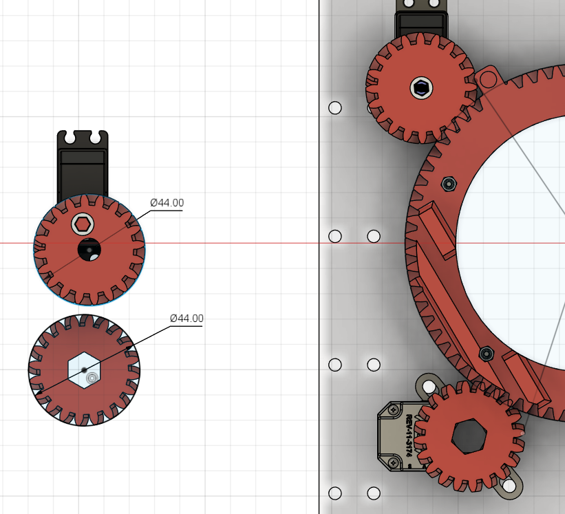
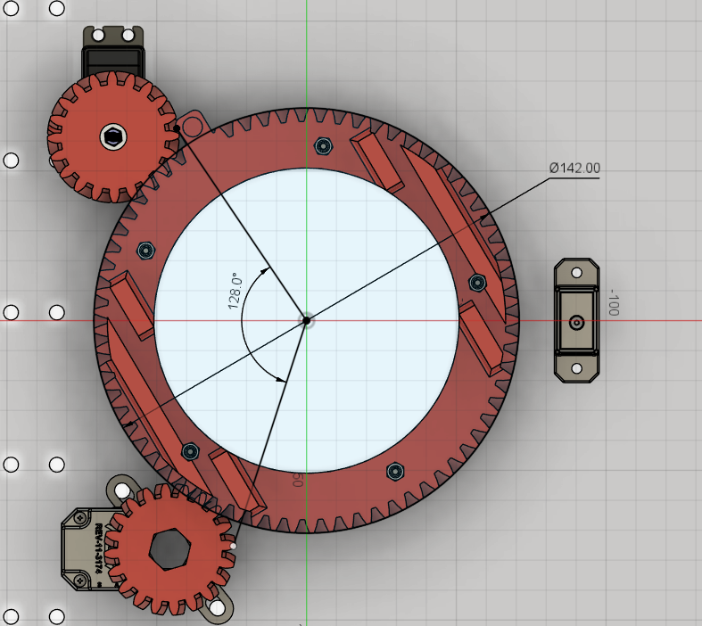

# Turret Bring-Up & Tuning

How to test the turret subsystem the first time it goes on the robot.

**Status:** **ran under power for the first time on 2026-10-20.** Steps 6, 7 and 8
were exercised on the robot: homing completes, the closed loop holds a target, and
the soft limits do stop the turret. The committed defaults were good enough as they
stand — no Panels retuning was needed to get this far.

Two things are still open, both written up under "Known open issues" at the bottom:
the soft limits are **overshot when jogging at full trigger**, and Step 3 (the
`MIN_POWER` deadband) was never actually measured — 0.12 just turned out to work.

Related files:
- `TeamCode/src/main/java/org/firstinspires/ftc/teamcode/subsystems/Turret.java`
- `TeamCode/src/main/java/org/firstinspires/ftc/teamcode/TurretTest.java`

---

## The hardware, and why the code looks like this

| Part | Detail |
|---|---|
| Servo | Dual-mode servo run in **continuous rotation (CR) mode** |
| Gearing | 20T pinion → 69T turret gear = **3.45:1 reduction** |
| Encoder | REV Through Bore V2 (REV-11-3174) on **its own gear** meshing the ring — *not* the servo pinion. 4-pin cable into the **`rf` drive motor's spare encoder port** |
| Home sensor | REV magnetic limit switch, digital port |
| Travel | **286°** total (22449 ticks / 78.51 ticks per deg) |

### Sharing the `rf` motor port

Every motor port has a motor connector *and* an encoder connector. The right front
drive motor doesn't use its encoder (odometry comes from the goBILDA Pinpoint over
I2C), so that connector was free and the turret encoder went there. No extra port
burned — nice.

The cost is coupling, so `Turret` is careful about it. It **only reads** `rf` —
never power, direction, run mode, or encoder reset. Keep two things true:

1. **`rf` stays in `RUN_WITHOUT_ENCODER`** (the default). Put it in
   `RUN_USING_ENCODER` and the hub would try to regulate the drive wheel's speed
   from the *turret's* position. Nothing does this today, and Pedro Pathing's
   `Mecanum` class doesn't either — verified in the 2.0.3 jar.
2. **Nobody calls `STOP_AND_RESET_ENCODER` on `rf`**, which would zero the turret
   mid-match.

One trap already handled in code: the SDK negates `getCurrentPosition()` for a
`REVERSE` motor (`DcMotorImpl.adjustPosition`), and this repo sets `rf`'s direction
*inconsistently* — Pedro's `Constants` says `REVERSE`, `RobotHardware` says
`FORWARD`. Left alone, turret angles would invert between TeleOp and auto.
`Turret.readRawTicks()` cancels the motor's direction out, so `ENCODER_DIRECTION`
is the only thing that controls turret sign. Don't "fix" turret sign by editing
`rf`'s direction — that belongs to the drivetrain.

**Why CR mode and not a normal servo:** 286° of turret travel × 3.45 = **987°** the
servo shaft has to turn. A standard servo maxes out near 270–300°, so it physically
cannot reach. CR mode has no travel limit.

**What that costs us:** a CR servo takes a *power*, not a position, and has no idea
where it is pointed. So the encoder is not a nice-to-have — it is the only thing
stopping the turret from winding itself into a hard stop. That is why `Turret` has
a state machine and a homing routine instead of a plain `setAngle()`.

### The four states

| State | Meaning |
|---|---|
| `NOT_HOMED` | Angle unknown. Soft limits **OFF**. Jog only. This is how it boots. |
| `HOMING` | Creeping toward the magnet. Aborts on timeout or stall. |
| `READY` | Angle is real. Soft limits ON. `setTargetAngle()` works. |
| `FAILED` | Homing failed. Power cut. Re-press X to retry. |

---

## Step 0 — Driver Station configuration

Add **two** new devices. The names must match exactly:

| Config name | Device type | Port |
|---|---|---|
| `turret` | Continuous Rotation Servo | servo port |
| `turretHome` | REV Touch Sensor | digital port |

**There is no separate encoder device.** The turret encoder is wired into the spare
encoder connector on the **right front drive motor's** port, so the code reads it off
the existing `rf` motor. Nothing new to configure for it.

Two gotchas:

- **The touch sensor shows up on the odd pin.** A REV touch/magnetic switch in
  digital port pair 0-1 configures as port **1**, not 0. Same as the existing
  `limitSwitch` device.

---

## Step 1 — Safety setup

- Robot **on blocks**, turret free to rotate through its whole range.
- Hands clear of the gears.
- Finger on the Driver Station stop button for the first homing run.
- Open **Panels**: connect to the robot's wifi, go to **panels.bylazar.com**.
  Every `Turret` constant is tunable there *while the op mode runs* — no redeploy.
  (Panels, not FTC Dashboard. Dashboard broke Driver Station pairing for this team
  and was reverted in `1692cbd` — do not add it back here.)

Run the **Turret Test** op mode (TeleOp, group "Test").

### Controls

| Input | Does |
|---|---|
| Right / left trigger | Jog positive / negative power (raw, analog) |
| `Y` | Toggle JOG ↔ HOLD (closed loop) |
| `X` | Start homing |
| `B` | "The turret is at 0° right now" — zeroes the encoder reference |
| D-pad left / right | HOLD mode: nudge target by `NUDGE_DEG` |
| `A` | HOLD mode: send target to 0° |

---

## Step 2 — Encoder direction

Tap the **right trigger**. Watch `Angle (deg)` on telemetry.

- Goes **up** → correct, move on.
- Goes **down** → set `ENCODER_DIRECTION = -1` in Panels.

Do not rewire anything to fix this. It is a sign flip.

---

## Step 3 — Find the deadband — **SKIPPED** (0.12 works; margin unmeasured)

Squeeze the right trigger **slowly**. Watch `Jog request` and the turret itself.

Note the `Jog request` value where the turret *actually starts turning*. Below that
the servo only hums, draws current, and heats up.

Set `MIN_POWER` to that value **plus about 0.02** of margin.

This matters: `MIN_POWER` is what the closed loop bumps small corrections up to. Set
it too low and the turret stops short of its target and buzzes forever.

---

## Step 4 — `TICKS_PER_DEGREE` and the range — **DONE 2026-10-15**

### The scale factor comes from the gear teeth, not from a sweep

```
REV Through Bore V2 (REV-11-3174)  = 8192 counts/rev
encoder gear 20T on the 69T ring   = 3.45 : 1
8192 × 3.45 / 360                  = 78.51 ticks/deg
```

Every term is an integer off a spec sheet or a tooth count, so this number carries
no measurement error at all. Confirmed in CAD on 2026-10-15:



Both small gears are **OD 44 mm**, the ring is **OD 142 mm**. At module 2 that is
20T (44 = 2 × (20 + 2)) and 69T (142 = 2 × (69 + 2)).

### The encoder is not on the servo's pinion



Two 20T gears mesh the ring: the **servo pinion** (top left) and the **encoder's own
gear** (bottom left, beside the REV-11-3174). Same size, so the encoder happens to
share the drive's 3.45:1 — but it is a separate path, not the servo's. Reading the
ring directly is the better arrangement anyway: backlash in the servo's gear train
cannot corrupt the position reading.

### The range, measured by hand

Measured with the **Turret Range Test** op mode (no power; push the turret by hand
to one hard stop, then slowly to the other, passing the magnet on the way).

| Landmark | Encoder ticks | Angle |
|---|---|---|
| Hard stop, clockwise end | **-9617** | -143.0° |
| Magnet switch (center of band) | **-124** | **-22.1°** |
| Hard stop, counter-clockwise end | **+12832** | +143.0° |

```
span   = 12832 - (-9617) = 22449 ticks
travel = 22449 / 78.51   = 286.0 deg
```

Ticks **increase counter-clockwise**, which matches `ENCODER_DIRECTION = 1.0`
(positive angle = counter-clockwise, viewed from above).

### Two earlier values were wrong — recorded here so nobody redoes the work

| Value | Where it came from | Problem |
|---|---|---|
| 106.90 | 22449 / a **guessed** 210° | the 210° was never measured |
| 95.73 | 22449 / a CAD angle read as 234.5°, then 232° | see below |
| **78.51** | **8192 × 3.45 / 360** | **nothing measured in it** |

The CAD travel is a reflex angle, which CAD would not dimension directly, so it was
read as `360 - 128`. If travel really were 232°, the sweep would have produced
`78.51 × 232 = 18,214` ticks. The encoder counted **22,449**. An encoder can be
geared unexpectedly, but it does not miscount by 23%.

The tape-and-count sweep settles it independently: **~2.6 encoder turns** counted by
hand, against the **2.74** implied by both 22449 / 8192 and by 286° of travel. A 232°
travel predicts only 2.22 turns.

**Sanity check on the robot:** 286° is about four-fifths of a full circle, 232° is
about two-thirds. If the turret visibly sweeps the smaller of those, stop and reopen
this — something here is still wrong.

---

## Step 5 — The magnet — **DONE 2026-10-15** (rebuilt mount)

Three Turret Range Test sweeps on the rebuilt magnet mount:

| Run | travel (deg) | `HOME_SWITCH_ANGLE` | band (deg) |
|---|---|---|---|
| 1 | 286.46 | -21.8 | 12.4 |
| 2 | 286.20 | -21.3 | 13.6 |
| 3 | 286.20 | -22.1 | 11.4 |
| **mean** | **286.29** | **-21.73** | **12.47** |
| spread | 0.26 | 0.80 | 2.20 |

`HOME_SWITCH_ANGLE = -21.73` is in the code. The magnet sits near the MIDDLE of
travel — about 121° from one hard stop, 165° from the other — which is why homing
searches both directions (Step 6).

### Read that table twice: travel is nailed, the band is not

**Travel repeats to ±0.13°.** That is the gear-teeth `TICKS_PER_DEGREE = 78.51`
confirmed by measurement, three times, on a number nothing in the sweep can fudge.
Treat 286.3° as settled.

**The band wanders by 2.2°** (11.4 to 13.6), and the edge by 0.8°. That is hand-sweep
noise: how fast you push changes where the trip gets sampled, because the switch is
only read once per loop. It is not the sensor being flaky.

It also no longer matters much. The band width used to set the accuracy of the zero
reference; since Step 6 re-approaches from a fixed direction at a fixed power, it
does not. Expect the powered approach to repeat better than these hand sweeps — once
homing works, home twice and compare the resting angle to see how much better.

### `HOME_SWITCH_ANGLE` is an EDGE

It is the angle where the switch first trips while travelling in `HOMING_DIRECTION`,
**not** the center of the band. An earlier draft of this doc said the width cost
nothing because homing "always approaches from the same side" — wrong twice: the band
is 12°, not the 5° first guessed, and the search arrives from either side. Step 6
exists to make the final approach consistent so this edge means something.

Turret Range Test reports that edge directly and labels which one it is, with both
edges and the center printed below it.

Polarity was confirmed with the **Magnetic Sensor Test** op mode: `open` with the
magnet away, `PRESSED` with it near.

---

## Step 6 — Homing — **DONE 2026-10-20**

Finger on stop. Press **`X`**.

Homing runs in three phases. The first finds the magnet; the last is the only one
that sets the zero reference.

**SEARCH** — the magnet sits mid-travel, so the turret may start on either side of
it and the search goes both ways:

1. Creeps in `HOMING_DIRECTION` (negative by default) at `HOMING_POWER`.
2. If it reaches a hard stop or runs out of time first, it **reverses once** and
   searches the other way. `Note` reads `hit a stop, reversing search`.
3. Switch trips → `Note` reads `found magnet, backing off`. **This trip is thrown
   away** — it could be either edge of a 12° band, depending on which way the
   search happened to arrive.

**BACKOFF** — drives back against `HOMING_DIRECTION` until the switch *releases*,
then `HOMING_BACKOFF_DEG` (8°) further, so the re-approach starts cleanly outside
the band. Waiting for the release rather than counting a fixed distance means this
works no matter how wide the band turns out to be.

**APPROACH** — creeps back in `HOMING_DIRECTION` at the slower
`HOMING_APPROACH_POWER`. The trip here *is* the reference: same edge, same
direction, same speed, every single time. State goes `READY`, and the turret drives
itself to `PARK_ANGLE` (0°, straight ahead) and holds.

What this buys: repeatability stops being set by the 12° band and starts being set
by loop timing — how far the turret moves between the switch tripping and the code
noticing. That is why the approach is deliberately slow.

Worst case is about 163° of travel to find the magnet, plus the back-off and
re-approach, so expect several seconds.

If it goes `FAILED`, read the `Note` line:

| Note | Means | Fix |
|---|---|---|
| `HOMING FAILED - hit stops both ways...` | Swept the whole range, never saw the magnet | Sensor not wired, not configured, or wrong name |
| `HOMING FAILED - timed out both ways...` | Never reached a stop or the magnet | Turret too slow at this power — raise `HOMING_TIMEOUT_SEC` |
| `HOMING FAILED - could not back off the magnet; switch stuck?` | Switch never released while backing away | Switch reading `PRESSED` constantly — check wiring and the magnet gap |
| `HOMING FAILED - magnet not seen on re-approach...` | Backed off, came back, never found it again | `HOMING_APPROACH_POWER` is below `MIN_POWER`, so the turret never moved |

The stall detector is the gear-saver. If homing reverses immediately in *both*
directions, do **not** raise `HOMING_POWER` to push through — either the turret
isn't moving at all, or `STALL_TICKS` is too tight for how slowly it creeps.

---

## Step 7 — Tune the closed loop — **DONE 2026-10-20** (defaults were fine)

Press **`Y`** for HOLD mode, then D-pad left/right to nudge the target ±10°.

| What you see | Meaning | Fix |
|---|---|---|
| Overshoots, swings back, oscillates | `kP` too high | Lower `kP` (start 0.010, try 0.006) |
| Crawls, takes forever | `kP` too low | Raise `kP` |
| Stops short and **buzzes** | Can't overcome friction | Raise `MIN_POWER` |
| Jitters on target constantly | Tolerance too tight | Raise `TOLERANCE_DEG` |

**Do not add I or D terms.** A CR servo's response is sloppy and laggy; an I-term
winds up against that and gives you a turret that hunts back and forth forever. Get
`kP` + `TOLERANCE_DEG` + `MIN_POWER` working first. If P alone genuinely is not good
enough, that is a conversation, not a quick constant tweak.

---

## Step 8 — Soft limits — **PARTIAL 2026-10-20** (limits work; overshoot open)

Once homed, in JOG mode, hold the trigger toward each end.

Expected: power cuts at ±140° — the soft limits, 3° inside the ±143° stops — `Note`
reads `at MAX limit` / `at MIN limit`, and jogging **back** still works.

**Result 2026-10-20:** the limits do engage and jogging back out works, but at full
trigger the turret overshoots the limit. See "Known open issues" below — this is a
braking-distance problem, not a scale-factor one.

If a limit is overshot, check the *speed dependence* before suspecting anything else:

- **Holds at low speed, overshoots at high speed** → braking distance. `TICKS_PER_DEGREE`
  is fine. This is the known issue below.
- **Overshoots by the same amount at every speed** → *now* `TICKS_PER_DEGREE` is
  suspect, and Step 4 is the place to go.

An earlier version of this step sent you straight to Step 4 for any overshoot. That
was wrong and cost real time: `TICKS_PER_DEGREE` comes from integer tooth counts and
was reproduced to ±0.13° across three sweeps. It is the last thing to doubt.

---

## Step 9 — Write the numbers down

Panels edits are **not saved**. They vanish when the op mode stops.

Record what you measured. Anything still blank is a starting guess, not a result:

| Constant | Original guess | Measured | In code? |
|---|---|---|---|
| `TICKS_PER_DEGREE` | 22.76 | **78.51** (from gear teeth) | ✅ |
| `HOME_SWITCH_ANGLE` | -105.0 | **-21.73** (an EDGE, rebuilt mount, 3 sweeps) | ✅ |
| `MIN_ANGLE` / `MAX_ANGLE` | -105 / 105 | stops at ±143, limits set **±140** | ✅ |
| `HOMING_DIRECTION` | -1.0 | -1.0 (searches both ways now) | ✅ |
| `ENCODER_DIRECTION` | 1.0 | 1.0 — ticks rise counter-clockwise | ✅ |
| `MIN_POWER` | 0.12 | **0.12 works** — but Step 3 was skipped, so the margin above the deadband is unknown | ✅ |
| `kP` | 0.010 | **0.010 holds target** — no oscillation seen on 2026-10-20 | ✅ |
| `TOLERANCE_DEG` | 2.0 | **2.0 does not jitter** | ✅ |
| `HOMING_TIMEOUT_SEC` | 6.0 | **6.0 was enough** — homing completed, so the 163° worst case fits | ✅ |
| `HOMING_BACKOFF_DEG` | 8.0 | **8.0 clears the band** — re-approach found the magnet every time | ✅ |
| `HOMING_APPROACH_POWER` | 0.15 | **0.15 moves the turret** — above `MIN_POWER` as required | ✅ |

Every constant is now a committed default in `Turret.java`, so all of this survives a
redeploy. Nothing lives only in Panels.

The three that were guesses — `MIN_POWER`, `kP`, `TOLERANCE_DEG` — were confirmed
*adequate* rather than *optimized*: the turret homed and held on the first powered
run without touching a single slider. That is a good outcome, but read the distinction
carefully. "It worked at 0.12" is not the same as "0.12 is right." Step 3 would tell
you how much margin you actually have above the servo's deadband, and that margin is
what decides whether a cold servo on a 40°F competition morning still moves. Worth
doing before a competition, not worth blocking on now.

---

## Known open issues

### 1. Soft limits are overshot when jogging at full trigger

Found in Step 8 on 2026-10-20. Jogging at full trigger carries the turret past the
±140° soft limit. **This is not a `TICKS_PER_DEGREE` problem** — do not go re-measure
Step 4 over it. The old wording of Step 8 sent people there and it was wrong.

`applySoftLimits()` cuts power *at* the boundary with no stopping distance:

```java
if (angle >= MAX_ANGLE && power > 0.0) return 0.0;
```

By the time the angle crosses 140° the turret is already at speed, and two things eat
the 3° of margin to the hard stop at 143°: the check only runs once per loop, and a
loaded CR servo does not stop dead when power is removed. Overshoot that grows with
speed is a braking problem, never a scale-factor problem — jog in slowly and the limit
holds fine, which is the diagnostic that separates the two.

**Why this is parked:** it is a JOG-mode problem. In HOLD mode `closedLoopPower()`
scales power with error, so the turret decelerates into its target on its own, and
`setTargetAngle()` clips to the soft limits before the loop ever sees it. Match code
drives the turret through `setTargetAngle()`, so auto-aim cannot trigger this.

**What would un-park it:** giving a driver a manual turret jog in TeleOp. Do that and
this bug is live in a match. Fix it first if that control gets added.

The fix, when it is worth doing, is to taper the allowed power as the limit gets close
rather than cutting at the edge — down to `MIN_POWER`, not to zero, and only in the
direction *toward* the limit so jogging back out always works.

### 2. Stall detection does not run outside homing

`isStalled()` is only called from the three homing phases. In JOG and HOLD, nothing
notices a jammed turret, so the code will keep commanding power into a servo that
cannot move — cooking the servo and risking teeth on the 69T ring. Combined with
issue 1, a full-trigger jog into a hard stop is unprotected.

---

## After it works

Not built yet, deliberately — do not start these until Steps 2–9 pass:

- **Integration.** Add a `Turret` field to `RobotHardware` so TeleOp and Auto share
  one instance. It is kept separate for now so a turret config problem cannot break
  the shooter tests.
- **Auto-aim.** `ShootAprilTag.alignRotationOnly()` currently aims by spinning the
  **whole drivetrain**. A working turret should replace that: feed the AprilTag
  bearing into `setTargetAngle()` and let the drivetrain hold still. Much faster, and
  it stops wrecking the robot's odometry heading mid-shot.
- **Homing in init.** Homing after `waitForStart()` burns match time. Moving it into
  the init loop needs a rules check first.
